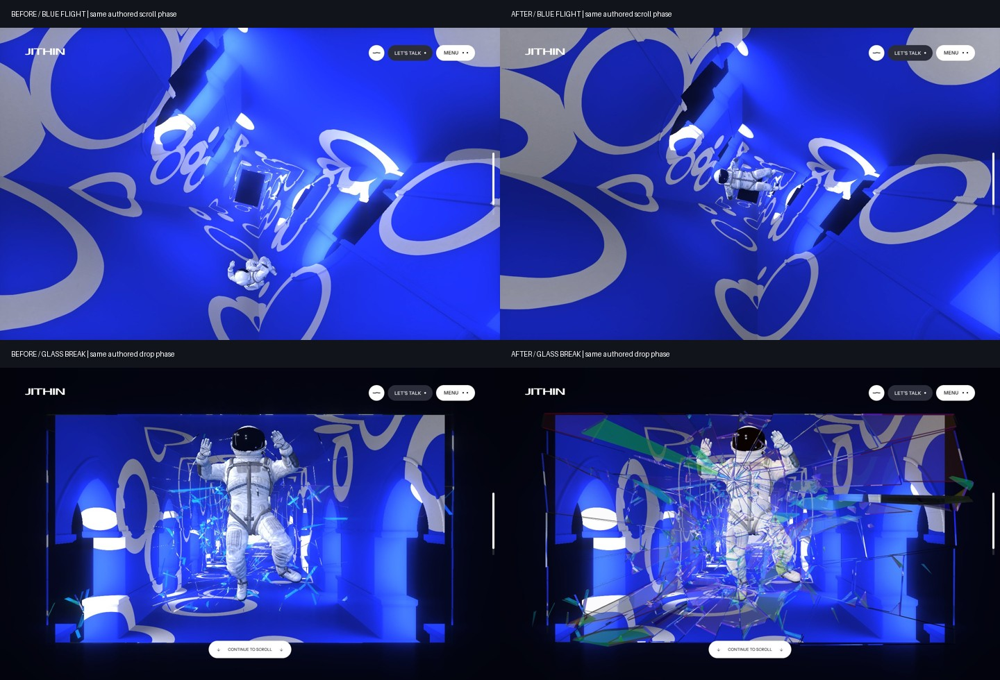
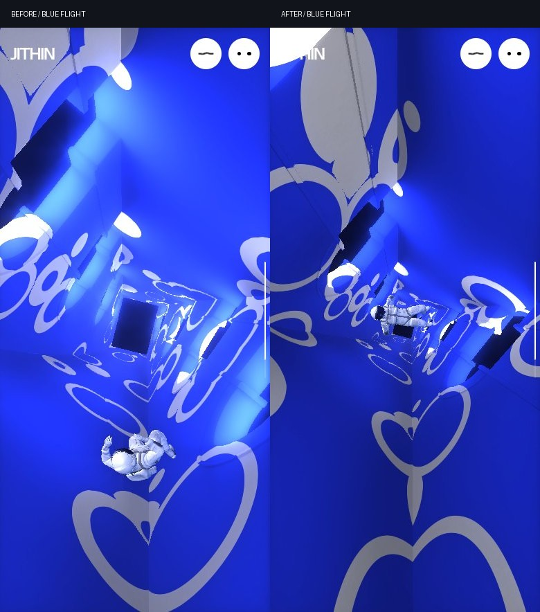

# Home cinematic framing, glass and whole-site follow-up

> **Current corrective pass:** [whole-project-graphics-audit.md](whole-project-graphics-audit.md) covers all 18 requested areas, the new native instanced/additive clone and decoded-media-readiness corrections (F34–F38), final build `o5CuzEoJWvEJZ5UwY8yTV`, 44 route/viewport observations, and the still-failing autonomous distinct-blue-pose gate. It also identifies About-footer footage in the supplementary recording at ~33s, superseding older blanket evidence-gap wording. Build identities and unresolved statuses below are historical.

## Result

The reported framing problem was reproducible. In the middle of the blue flight, the astronaut was substantially below the tunnel’s center. This was not solved by enlarging the viewport, clamping the astronaut to the screen, or arbitrarily moving the camera. The build was applying the later monitor pull-back coordinate to effects that belong to the earlier blue-flight coordinate.

**Shipped in this pass:** corrected flight turbulence, camera-aperture and bloom phase inputs; removed the extra glass-animation delay; restored post-display glass/astronaut composition and the glass’s near-camera depth. The approved gallery clarity, thumbnail opening/reverse, Home opening/editorial, About and Projects implementations were not retuned.

**Not an exact-clone certificate:** native astronaut shading/animation dynamics and some shared-site choreography remain adaptations. The final autonomous normal-motion sampling gate still fails in Chromium/SwiftShader; it is explicitly separated from passing authored-phase rendering tests below.

### Current production identity

- Preview **3003**, process **`website-df3e8db7`**.
- Next production build **`eVMxYxj-7MeL2vwLW0AY3`**.
- **22 HTML responses + 26 unique served JS/CSS files** matched the current `.next` build byte-for-byte.
- Baseline: **`e36f200`**, build `6xmQgQMijkAfWzQ5gJRNF`. Intermediate candidates, including `ZfuAiy-YPc7MNGzuKfwdk`, are superseded.

## Evidence and limits

1. **Supplied Home film:** `public/videos/Lusion-home.mp4`, 1920×1080, encoded 60 fps, approximately 45.45 seconds. Opened the overview and a new detailed shaft→vortex→blue→glass contact sheet. Individual accurate seeks at **32.0–39.0 seconds, every .5 seconds**, show green shaft lighting, the pink stereographic fold, an intentionally intense transition flash, a blue corridor with a centrally travelling astronaut, monitor withdrawal, then flat refractive fragments. This is recorded visual evidence, not a measured live input/DPR/viewport trace. The exact-seek sheet is `temp/home-tunnel-framing/reference/exact/sheet.jpg`; earlier fps-filtered overview labels are not used as exact timing measurements.
2. **Archived native program:** [Design_Lusion.co](https://github.com/quangminh1212/Design_Lusion.co), blob `0c57277a2102a61f761357ce2cd432d035cd0a13`; inspected local `temp/preview-recovery/inspection/reference.js`. Relevant sections: Brownian/second-order dynamics around 33400+, astronaut transforms 35200+, glass 35654+, range weights 36519+, tunnel camera/bloom 37000+, effect ordering 47956+/50203+. Source constants explain the defects; they do not prove the current live site is identical to this archive.
3. **Current live content:** refreshed [Home](https://lusion.co/), [About](https://lusion.co/about), [Projects](https://lusion.co/projects). These confirm the 12 featured items, 19 canonical projects, About content and section identities. Text fetches **do not render WebGL**, so they cannot certify current live lighting, physical response or camera parity.
4. **Local served build:** before/after captures at 1440×900 and 390×844; fresh normal/reduced authored-phase WebGL tests; full reduced-motion reversal/fallback tests; all canonical pages observed again. Chromium uses SwiftShader; mobile is emulated. No hardware FPS, physical-phone result or synchronized original-site pixel score is inferred.

## Before / after



Both columns use the same local authored phase: tunnel `.90`, then drop `.20`. They are **local before/after comparisons**, not frames claimed to have identical original-site input history. The lower comparison includes the corrected render layer/depth as well as the earlier fracture onset.



### Framing measurement

At tunnel `.90`, the projected **root/pivot** moved as follows:

| CSS viewport | Before root Y | After root Y | Viewport center |
|---|---:|---:|---:|
| 1440×900 | 709.60 px | 443.17 px | 450 px |
| 390×844 | 619.00 px | 418.74 px | 422 px |

These are projected root coordinates, **not head landmarks or skinned-body bounds**. The images establish the accompanying visible-body improvement. Baseline projection was reconstructed from captured root/camera matrices; the baseline camera FOV solved from the captured dolly was 45° desktop / 54° mobile. Final telemetry exposes the actual FOV and projected root directly. No claim is made that every limb must fit during the intentionally cropped emergence close-up.

## Confirmed defects and changes

### F29 — flight turbulence belonged to the wrong phase

**Before:** white-flight displacement/rotation faded against `tOutPull`, the later DOM monitor easing. A native five-unit displacement and fifteen-unit rotation amplitude remained active through too much of the corridor. This displaced the subject well below the vanishing point.

**Reference:** `whiteFrameRatio` is the standalone blue-flight range. Its weight is **2**, followed by weight **1** for `whiteFrameOut`. The combined white/root curve therefore maps to:

```text
whiteFlight = clamp(combinedWhite * 1.5)
positionAmplitude = 5 * (1 - clamp(whiteFlight / .75))
rotationAmplitude = 15 * (1 - clamp(whiteFlight / .75))
```

**Fix:** `goalWhiteFlightState` supplies these separate coordinates. Blue noise fades before the later monitor withdrawal rather than tracking it. Changing noise frequency now advances an integrated phase instead of multiplying an absolute clock by a changing frequency; it starts at the existing black-flight terminal noise phases. The praised black flight is unchanged. Captured root transforms and world scale remain authoritative: no viewport clamp or fake centering offset was introduced.

**Remaining:** the original uses random initial phases and second-order dynamics; the build retains deterministic seekable noise, not an exact reconstruction of that history.

### F30 — camera aperture and blue bloom used the same wrong late input

**Before:** aperture FOV and bloom’s `4→2` reduction waited for monitor withdrawal. The blue flight retained the earlier projection/bloom state too long.

**Fix:** projection now uses the standalone blue-flight ratio; bloom uses the reference’s **first .05 of that ratio**. Existing dolly compensation, pointer behavior, `.208` world scale and late CTA framing are retained. In particular, native camera `25→24` correctly maps to local `5.2→4.992`; resetting the camera to world zero would have been wrong.

The flash is **not removed**: the supplied film genuinely has a strong shaft→blue transition. This fix changes the phase wiring, not an arbitrary brightness ceiling.

**Remaining adaptation:** 54° mobile expectation and the late 60°/76° CTA interpolation are local framing choices. The desktop film does not establish a native 76° mobile camera, regardless of older code comments. Native viewport offsets must be reconciled against actual local layout before any further camera adjustment.

### F31 — glass had an invented 18-percent onset delay

**Before:** shards were invisible until drop `.18`, then sampled a second remapped `.18→.96` interval. The captured animation lagged the breakthrough pose.

**Fix:** positive drop immediately samples the captured animation:

```text
frame = sin(clamp(drop) * pi/2) * 14
fragmentScale = 1 - clamp((drop - .75) / .25)
```

All **946 pieces / 15 frames** remain intact. No synthetic thick shards, extra sidewalls, simulated explosion or decorative glass cage was added. Existing local non-depth-writing/double-sided shard settings remain an adaptation, not a claim about every original material default.

### F32 — fracture coverage was being fed into bloom

**Before:** glass was part of the main scene, rendered **before** the FFT display. Its coverage alpha could be interpreted as bloom-selection data. Refraction came from an extra, downscaled, pre-display redraw rather than the finished tunnel image. The astronaut also remained inside the bloom stage after the reference’s foreground handoff.

**Reference:** Bloom order **10**, Final **30**, PreUfx **50**. Glass belongs to PreUfx; the astronaut is transferred there when the combined white curve ends.

**Fix:** new `GoalReferenceOverlayPass`:

1. Read the completed composer image, never the current output attachment.
2. Copy it with opaque display alpha.
3. Clear depth/stencil, not color.
4. Render glass and the emerged astronaut afterward.

The pass uses the existing camera/composer/owner and has **no RAF, scroll listener or extra scene-capture target**. It removes the old duplicate refraction scene draw and its render target. The current suit uses PBR rather than self-lit native materials, so the late layer receives synchronized light copies; material display alpha is separated from light-selection alpha. Warmup exercises this foreground variant, and teardown clears both scene containers.

### F33 — glass shared the distant stencil plane instead of the near-camera frame

**Before:** glass shared the world-z=0 monitor stencil plane, roughly five local units away. Scaling a rigid trajectory to that plane is not the same physical projection as the native glass near the lens.

**Fix:** glass uses native `EndCameraDepthToFrame = 2`, scaled to **`.416` local units**, with camera-relative position and the existing monitor aperture/rotation. The monitor stencil remains separate. This preserves the initial aperture fit while restoring near-camera shard motion and clipping. The final display/foreground split makes those trajectories glass, rather than an extra luminous architecture layer.

## What was deliberately not changed

- Captured root/pose assets, model centering, black architecture instances/fold equations, blue Voronoi geometry, end gems/stickers and emergence choreography.
- Approved Home hero/editorial, About hero/team/awards/expertise/particle pour, Projects depth archive.
- Approved thumbnail/list opening, origin-aware reverse and the four gallery-clarity fixes.
- Fonts remain **Option 2**; JITHIN branding remains intentional. No inspection bypass, dependency, analytics/SEO/robots/metadata/newsletter change.
- No duplicate RAF/scroll owner, CSS transform pretending to fix the 3D subject, invented particles in project films, or global color retune.

## Actual verification

### Final production build

| Gate | Result and scope |
|---|---|
| Production build, ESLint, strict TypeScript, diff check | **PASS**. Build identity above. |
| `test-goal-sequence.mjs` | **PASS**: 1,001 blue-flight/bloom/noise/glass samples; integrated frequency continuity; native buffers/counts/rig/root/atlas/FFT tests; overlay copy→foreground order, source texture/dimensions, no attachment alias, renderer-state restoration including exceptions, glass depth and illuminated late-layer ownership. Numerical/renderer-double tests, not original-site pixels. |
| `test:motion` | **PASS**: existing clock, pointer decay, numerical springs/native hero solver and policy contracts. |
| `validate-home-tunnel-framing.mjs` | **PASS, 68 observations**: 17 phases × desktop/mobile × normal/reduced **authored seeks**. Finite camera/root transforms, centered late-blue pivot, native instance counts, early/late glass samples, loaded refraction, opaque nonblank central pixels, GL NO_ERROR, no overflow/errors. Not an autonomous frame-delivery test. |
| `validate-goal-sequence.mjs`, reduced | **PASS at 1440×900 and 390×844**: 11 states each, exact reverse state/GPU pixels, four handoff-continuity probes, CTA layout/hit target, fast native scrolling, zero errors/failed expected assets, listener/canvas/range cleanup, astronaut/glass/WebGL failure isolation. |
| `audit-site-fidelity.mjs`, `home-tunnel-final` | **44 observations**, all 22 canonical routes × two widths: **0 uncaught errors, 0 horizontal overflow**. Reduced-motion inventory, not full moving/reference coverage. |
| Actual Atlas gallery clarity | **PASS**, DPR 1/2: exact 1440×900 / 2880×1800 buffers, GL error 0, stationary blur strength 0/0/0. Prior clarity preserved; DOM/media RMSE is calibration, not native likeness. |
| Thumbnail/reverse lifecycle | **PASS**: reduced keyboard open/next, Home origin through case chain, source quarter-viewport return, direct entry, actual mid-zoom context loss/fallback, resize and Escape cleanup. |
| Served identity | **PASS**, 22 HTML + 26 JS/CSS assets byte-matched. |

### Important failure — not hidden or weakened

The **final default normal-motion autonomous** `validate-goal-sequence.mjs` run still fails **“all intermediate stages visibly play.”** It records 206 playing timer polls but only **10 distinct rendered progress samples**, including one distinct sampled blue pose, over approximately **22.947 seconds** including preparation/start timing. Zero uncaught errors or failed asset requests were recorded. Repeated polls of the same telemetry must not be counted as rendered frames.

Earlier candidates also failed the blue-pose/stage-sampling checks in both multiprocess and single-process software Chromium. These attempts are retained in the compact evidence summary. No assertion was relaxed, no cinematic clock slowed to manufacture more samples, and no low-DPR special test was represented as a default pass. The new 68-observation test verifies actual normal-mode **phase renders**, not this separate autonomous acceptance.

This is a real validation limitation for the software-rendered preview path and a priority for further profiling. It does **not** establish physical GPU/mobile FPS or prove where every delivery stall originates. The native 81-neighbor field, instanced architecture and FFT need GPU-time/driver/frame-submission investigation before choosing a quality adaptation. Do not claim that this release solves every motion/performance issue.

### Additional protected-feature checks during this pass

Before the final post-display-layer correction, the earlier candidate also passed normal Home editorial (real film/depth pixels, modal/links/cleanup), About expertise (two real ribbons/visible pixels, stagger/bob/reverse, keyboard/mobile/reduced/context recovery), Projects archive/CTA (19 depth images/links, atlas pixels, gestures, recovery/disposal), and the case/shadow/zoom/navigation/editorial/archive unit suites. Those non-cinematic modules did not subsequently change. They are **same-pass earlier-candidate checks**, not silently relabelled final-build executions.

## Whole-site graphics audit: remaining work, in priority order

This is a refreshed engineering backlog, not a statement that every route’s motion has now been compared frame-for-frame. Previously shipped corrections must not be listed as still missing.

| Area | Current diagnosis / evidence level | Precise recommendation and acceptance |
|---|---|---|
| **P0 — Home autonomous delivery** | Final software-browser sampling failure above; authored phase renders pass. Hardware cause/performance unknown. | Record distinct submitted/presented frames and phase-correct GPU queries, separating compilation, driver backpressure, CPU work and hidden preparation. Test a physical GPU/phone before selecting an adaptive pixel/FFT policy. Keep the 20-second authored clock and one owner; require distinct blue/glass frames, controls/cancellation and final handoff, not repeated timer polls. |
| **P1 — astronaut material + skinning** | Actual source mismatch: archive uses separate white/black/clone self-lit shaders and two-influence **linear** transformed-point blending. Current rig uses PBR and a local dual-quaternion adapter. Its detailed silhouette is present, but it is not the same shading/deformation program. | Port downstream material families and frame interpolation behind the existing emergence boundary. Preserve captured buffers/resource ownership. Compare suit/visor silhouettes, glove seams, AO, metal response and reflected tunnel lighting at matched root/pose frames. Do not globally replace praised emergence lighting. |
| **P1 — vortex clones** | Baseline capture shows bright opaque suits; native clone program is additive/reflection-driven and fades toward the fold. Local clones share the primary material family. | Isolate clone material ownership; restore feedback/environment-driven color, blend/depth behavior and source fade. Reference uses the real suits, not arbitrary green sprites. Compare visibility/occlusion against the 32–35 second film window. Do not add a new central cage or ring: the shaft’s stereographic fold already creates the vortex. |
| **P1 — astronaut motion dynamics** | Fade/white frequency wiring fixed; random phase history and native second-order filtering remain adapted. | Reconstruct the source position dynamics `(frequency 1, damping .65, response 1.3)` and rotation dynamics `(1, .85, 1.1)` with deterministic checkpoint/replay if needed for seeking. Include clone root/noise basis and loop-time modulation. Require forward/reverse and pause continuity without a second live clock. |
| **P1 — glass/monitor final calibration** | Onset, render stage, background input and physical depth fixed. Local DOM aperture, sidedness/depth-write and monitor layout still differ from the original global page manager. | Compare exact crack/impact/drop phases at the recording’s inferred viewport, then portrait. Check native viewport offsets, stencil edge fit, foreground depth/occlusion, apparent shard speed and final shrink; never retune all axes from a single still. Preserve opaque display alpha and post-display placement. |
| **P1 — all 19 case studies** | Approved crisp scroll, native foliage/shadow pipeline, fullscreen mask and selected-list/reverse are present; no longer the old generic-only opening defect. Residual source readiness/highlight and text-emphasis/lifecycle behavior remain open. | Gate image/video ready ratio separately from media active reveal; restore highlight→texture behavior, active reset, viewport text emphasis and metadata/panel entrance from source. Test slow/missing media, keyboard next, scroll next, mobile and reverse. Do **not** add generic parallax where captured media has no nondefault parallax value. |
| **P2 — shared loading / slow route preparation** | Existing loader is usable but not source-equivalent rolling digits/bar/slow-load words. Text fetches cannot validate those states. | Drive progress from actual eligible asset work, reproduce digit/bar/word phases under throttled delivery, preserve focus/fallback and font allowlisting. Do not falsify progress or add an unrelated loader clock. |
| **P2 — shared footer / menu / route polish** | Native generic aperture, menu stagger and portal charge already shipped. Residual footer entrances and specialized case metadata/next blending are not all reference-equal. About film does not show its footer. | Capture the missing rendered states before adjusting their timing. Test long/short desktop and portrait, focus, Escape, pending navigation, Back, reduced mode and source restoration. Do not treat unseen About-footer behavior as film-confirmed. |
| **P2 — Home upper sections** | Native hero neighbor/material/physics work and editorial ribbon/reel/depth cards already exist. Film, depth hover/release and upper motion checks passed earlier in this pass; no new discrepancy justified changing them. | Preserve these implementations. Further tuning needs matched pointer/input histories, film time, aspect and deterministic physics state. Do not infer a missing effect merely because a static capture freezes it. |
| **P2 — About hero / team / brands / awards** | Source assets and approved choreography remain. Random/noise history, depth/fog and exact material/camera calibration are not universally synchronized with the film. | Compare stable matched camera/scroll/selection states before any calibration. Preserve source-team selection/morphs, existing awards counts, interactions and responsive policies; no blanket material brightness or camera retune. |
| **P2 — About expertise / contact** | Native staggered cards, real ribbons and approved cursor-held downward pour already shipped and passed same-pass tests. Not missing particle systems. | Protect visible ribbon contribution, per-card depth, hover/focus legibility, collective falling-particle wake, quick-click mailto, release/cancel and context recovery. Any remaining polish must be demonstrated against an actual filmed phase. |
| **P2 — Projects archive** | All 19 depth cards, native text/CTA, keyboard/gesture behavior and selected-card expansion exist. Not a flat-image archive requiring arbitrary tilt. | Preserve current list transform/depth/focus and origin-aware reverse. Calibrate residual source loading and transition depth using selected-project footage, not a global hover-zoom change. |
| **P2 — cursor / sound** | Source-informed behavior exists; complete pointer/audio envelope parity has not been measured in this pass. | Compare hover target/cursor states, mute persistence, gesture unlock and scene audio envelopes with recorded inputs. Keep cancellation, hidden/menu/modal pauses and a single audio journey owner; do not add autoplaying sources. |
| **Intentional boundary — fonts / branding / fallback** | JITHIN and Font Option 2 remain deliberate. DOM/reduced/WebGL-failure paths are accessibility adaptations. | Do not silently activate commercial faces, undo branding or remove fallbacks to improve a screenshot score. Report those differences explicitly. |

**Project films are not missing runtime physics.** Many cloth, particles, simulations and 3D shots in case media are encoded films/images. Rebuilding those as live page-level simulations would invent behavior rather than clone it.

### Canonical page coverage

Home `/`, About `/about`, archive `/projects`, and all nineteen cases were observed at both widths:

`oryzo_ai`, `atlas_motion`, `devin_ai`, `of_the_oak`, `everswap`, `porsche_dream_machine`, `synthetic_human`, `ddd_2024`, `spaace`, `choo_choo_world`, `zero_tech`, `spatial_fusion`, `worldcoin`, `lusion_labs`, `my_little_story_book`, `soda_experience`, `infinite_passerella`, `the_turn_of_the_screw`, `maxmara_bearings_gifts`.

Utility/alias routes are not additional original canonical pages. The external Labs experience was not rendered in this pass.

## Evidence and reproduction

Committed compact evidence: [summary](../validation/home-tunnel-framing/summary.json), desktop/mobile before/after images above. Detailed reports, exact film extracts and captures remain ignored under `temp/`:

- `temp/home-tunnel-framing/{before,final-validation,reference/exact}/`
- `temp/cinematic-validation/{1440-reduce,390-reduce,1440-no-preference}/report.json`
- `temp/site-fidelity-audit/home-tunnel-final/report.json`
- `temp/home-tunnel-framing/{production-identity.json,final-gallery-regression/}`

```bash
node scripts/test-goal-sequence.mjs
BASE_URL=http://127.0.0.1:3003 node scripts/validate-home-tunnel-framing.mjs
BASE_URL=http://127.0.0.1:3003 GOAL_VIEWPORT_WIDTH=1440 node scripts/validate-goal-sequence.mjs
BASE_URL=http://127.0.0.1:3003 GOAL_VIEWPORT_WIDTH=390 node scripts/validate-goal-sequence.mjs
# Separate autonomous acceptance, currently failing its sampling gate here:
BASE_URL=http://127.0.0.1:3003 GOAL_MOTION=normal GOAL_CAPTURE=0 node scripts/validate-goal-sequence.mjs
```

The baseline capture helper `audit-home-tunnel-framing.mjs` records observations only. Point it at the build being examined and choose `TUNNEL_AUDIT_OUT`; rerunning it now captures the fixed build, not the preserved baseline.
