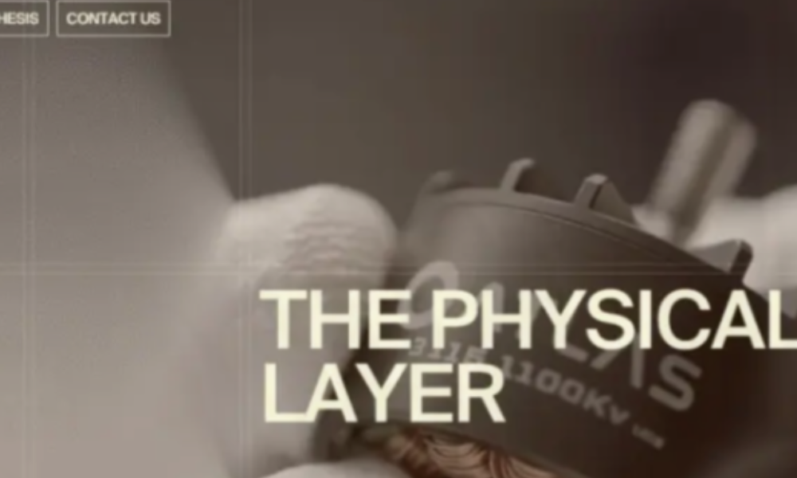

# Project-scroll clarity audit and whole-site delta register

> **Current corrective pass:** [whole-project-graphics-audit.md](whole-project-graphics-audit.md) covers all 18 requested areas, the new native instanced/additive clone and decoded-media-readiness corrections (F34–F38), final build `o5CuzEoJWvEJZ5UwY8yTV`, 44 route/viewport observations, and the still-failing autonomous distinct-blue-pose gate. It also identifies About-footer footage in the supplementary recording at ~33s, superseding older blanket evidence-gap wording. Build identities and unresolved statuses below are historical.

> **Latest Home cinematic follow-up:** [home-tunnel-framing-audit.md](home-tunnel-framing-audit.md) records the astronaut/blue-flight phase correction, glass timing, post-display foreground composition and near-camera glass depth (F29–F33), final-build evidence, the still-failing software autonomous sampling gate, and the refreshed whole-site backlog. Current preview 3003 is build `eVMxYxj-7MeL2vwLW0AY3`; identities below describe their historical passes. Approved gallery/thumbnail fixes are retained.

## Result

**Four confirmed rendering/motion defects are fixed in the shared renderer used by all 19 case studies.** The accepted thumbnail opening/reverse is retained. Production preview **3003** serves build **`6xmQgQMijkAfWzQ5gJRNF`**, verified against **22 generated HTML files and 26 referenced JS/CSS assets**, all byte-identical and HTTP 200.

Baseline for this pass: application **`7fed190`**, build **`Q-EZhr3zZU6Ewin09idjd`**. The earlier selected-opening defect is **not** still the current primary problem. This follow-up addresses the user's new observation: gallery images and scroll motion look excessively blurry.

This document updates, rather than silently replacing, the historical [whole-site F01–F24 audit](full-experience-fidelity-audit.md) and [opening implementation](../validation/project-thumbnail-zoom.md). It covers every canonical page family and all 19 cases, distinguishing implemented fixes, known remaining differences and effects that need further matched-motion evidence. It cannot establish literally every hidden state or physical-device difference.

## 1. Evidence and comparison boundaries

- Rechecked the supplied `public/videos/lusion-project-opening.mp4`: **24.57s, 1920×1080, 60fps**, SHA-256 **`c3fbb8e8fb41691c0e9e9245cdd0a9238509d3b6da8b8eb657ae2d31c175319d`**. Revisited its existing extracted gallery frames at approximately **10.5–16s** and Atlas **22.5/24s**, alongside the opening/reverse sequences. Clear resting media and brief scroll distortion are not a license to smear the entire gallery continuously. Encoded frame rate is not measured browser FPS, and the film does not establish source DPR or exact input timing.
- Re-read the native `ProjectDetailsScreen`, `ProjectDetailsItem` and `ScrollPane` implementation: local inspected `temp/preview-recovery/inspection/reference.js`, original Git blob **`0c57277a2102a61f761357ce2cd432d035cd0a13`** from [Design_Lusion.co](https://github.com/quangminh1212/Design_Lusion.co). Key regions: **37670–37925** (screen/shadows), **38540–38835** (media/fullscreen/readiness), **47415–47510** (per-frame scroll displacement).
- Fresh live text retrieval succeeded for [Home](https://lusion.co/), [About](https://lusion.co/about), [Projects](https://lusion.co/projects), [Oryzo](https://lusion.co/projects/oryzo_ai) and [Atlas](https://lusion.co/projects/atlas_motion). This supports current content/order, **not a newly rendered live WebGL comparison**. The existing Home/About/Projects supplied films remain the scene authorities; About's footer is not visible in its film.
- Recorded before/after browser calibration at **1440×900, emulated DPR 1 and 2**, plus the real Atlas image at the same geometry. Calibration replaces one image and suppresses plant loading **inside its disposable browser only**, to isolate raster resampling; no assets or production behavior are replaced. Real-media mode does neither.
- Fresh production coverage: **38 case-study route/viewport layout checks**, **44 canonical page observations**, normal-motion opening/return regressions, real preview playback and actual wheel/keyboard case navigation. These are scoped checks, not an all-page exact-pixel certificate.

## 2. Confirmed causes and implemented fixes

### F25 — P0: scroll displacement was integrated a second time

**Before:** `velocity = clamp((velocity + delta) * exp(-10 * dt), -.15, .15)`, then fed into the native-looking eight-tap shader. Lenis already smooths document position. Adding each displacement into persistent velocity amplifies the trail and produces residual distortion when movement has stopped.

**Reference:** `scrollViewDelta = scrollView - previousScrollView`; `u_scrollXStrength = min(.15, active ? scrollViewDelta : 0)`. The final shader uses that current displacement for its transverse cosine wave, blue-noise offset and eight directional samples.

**Fix:** use the current normalized displacement directly; no accumulated velocity or second decay. Reset the previous-scroll baseline on layout measurement so resize/breakpoint changes do not create fictitious motion. Keep the existing symmetric ±.15 safety bound for extreme jumps and zero in reduced motion. The symmetric reverse bound is a documented safety adaptation; the inspected source only explicitly caps positive displacement.

At a theoretical steady 60Hz with no saturation, the former integrator amplifies a constant delta by about **5.5×**. That is a calculation, not measured hardware behavior. In the actual baseline software trace, distortion remains nonzero after scroll position has stopped; after the fix, every sampled stationary frame is exactly zero. The reference's **eight taps, noise and wave coefficients are retained**—the fix is not to disable motion design.

### F26 — P0: the media pass was capped at 1.4 megapixels

**Before:** `min(deviceDpr, 1.5, sqrt(1400000 / viewportArea))`. A larger viewport could be rendered below one pixel per CSS pixel, and a Retina viewport barely above 1×.

**Reference:** media screen RT follows the presentation dimensions; the separate plant/shadow passes deliberately use lower resolutions. Blurring/downsampling the shadow field is not a reason to downsample the image pass.

**Fix:** use the existing shared **UHD pixel budget / maximum 2× DPR**, additionally limited by the GPU's maximum texture dimension. Retain the shadow pipeline's own lower-resolution targets. No blanket software-only low-resolution branch or CSS sharpening filter is introduced.

| 1440×900 viewport | Before canvas | After canvas |
|---|---:|---:|
| Emulated DPR 1 | 1440×900 | 1440×900 |
| Emulated DPR 2 | 1496×935 | **2880×1800** |

The 2× check now has **3.706× as many presentation pixels**. It does not mean 3.706× sharper perception, better source footage, or faster rendering. Large/high-DPI views remain bounded to UHD/2× rather than unbounded 8K allocations.

### F27 — P1: presentation and media RT sampled different pixel grids

**Before:** Three floors drawing-buffer sizes, while the media RT used `ceil(w*dpr)`. At the old fractional 2× policy, the canvas is **1496×935**, but the intermediate target would be **1497×936**. Final composition resamples the whole image even at rest.

**Fix:** query `renderer.getDrawingBufferSize()` after resize and use those exact dimensions for the media RT. Unit tests cover odd dimensions, fractional DPR and texture-size limits. This is independent of increasing the pixel budget.

### F28 — P1: fullscreen masks incorrectly shrank with entrance zoom

**Before:** both rounded mask size and UV zoom consumed `uReveal`, so a fullscreen portrait/video could begin as a smaller inset rectangle despite its full-height layout and zero desktop corner radius.

**Reference:** mask expansion uses `max(u_isFullscreen, u_activeRatio)`; UV zoom still uses `u_activeRatio`.

**Fix:** pass fullscreen state independently to the material. Fullscreen masks cover their full box from entry while the image's internal UV entrance still animates. Ordinary panels retain their existing rounded reveal. This closes the fullscreen-mask part of **F21**, not all independent readiness/highlight/opacity work.

## 3. Visible evidence and limits on image enhancement

Real Atlas asset, same crop, 1440×900 viewport at emulated 2× DPR. These are actual browser crops; neither has been sharpened or generated. Some optical softness is already present in the asset, especially behind its title.

**Before:**



**After:**


The isolated checker/text calibration's GPU-versus-DOM RMSE at 2× drops **53.447 → 31.889**; at 1× it remains **30.796 → 30.796**, as expected for the same buffer size. This metric isolates this fixture's sampling differences, not visual distance to lusion.co. GPU mipmapping and DOM image resampling need not be identical. Real-media RMSE also includes lighting, so it is not used as an isolated sharpness score.

Do not conflate four kinds of softness:

1. Unintended low-resolution/resampling softness — corrected here.
2. Over-accumulated scroll smear — corrected here.
3. Intentional depth-of-field in Home/archive hover and the approved selected-image zoom — **preserved**.
4. DOF/motion blur/compression already inside bundled project films/images — cannot be removed faithfully by a runtime sharpen filter or invented detail. Obtain a verified higher-resolution rendition if the reference proves one is needed.

The captured metadata flags **two Devin video entries and one Of The Oak video entry** with an actual dimension below a layout declaration. This is a source-resolution risk, not proof that a better native rendition is available or that those clips should be AI-upscaled. Metadata was inventoried, not independently re-encoded/remeasured in this pass.

## 4. Whole-site effect inventory: what remains, what must not regress

| Requested effect / surface | Current assessment | Precise next action / acceptance |
|---|---|---|
| Project scrolling, motion blur, polish / all 19 cases | **F25–F27 fixed.** Native wave/noise/eight taps remain; normal input/drag/Next still works. | Compare synchronized media time and displacement traces on physical GPUs, including reverse wheel and touch. Do not replace the signed per-frame input with another accumulated velocity. |
| Gallery animations, fullscreen, depth | **F28 fixed.** Existing ExpoOut UV entrance and RGB plant shadows remain. Separate native ready/highlight/opacity state is still incomplete (F21). | Introduce independent texture-ready time and page-active opacity in the same case owner; verify highlight→image, decoded-video first frame, re-entry and fullscreen independently. Preserve semantic DOM fallback. |
| Thumbnail hover, parallax, selected transition / Home and archive | Accepted depth/DOF and 7fed190 opening/reverse retained; four fresh normal-motion regressions pass. F08 fallback shadows/fitting still differs. | Remove unsupported blue fallback shadows only after checking the asset crop; don't globally disable thumbnail blur. Conditional gallery `parallax` data is not wired, but no verified non-1 values exist in the active captures—do not invent a generic image pan. |
| Particles, cloth/coasters, drones and 3D object physics / project films | Much of the visible project object motion is **embedded film content**, not runtime particles or rigid-body objects. | Match asset/rendition, playback state and time first. No speculative confetti, cloth solver, coaster mesh or new light rig is justified by the film. |
| Camera movement / project galleries | Orthographic DOM-aligned screen; horizontal desktop and vertical ≤812px axes retained. | Treat scroll as layout translation plus the source screen distortion, not a perspective camera dolly. Verify 812/813 and short-height layouts; these gates passed. |
| Special text motion / Of The Oak and Worldcoin | **F24 open:** text content/order exists, but native progressive emphasis is not reproduced by static paragraphs. | Keep semantic readable text; map emphasis to the source viewport window .2–.8 and `50/max(30,textLength)` timing; reset offscreen; reduced mode fully readable. No font-policy bypass. |
| Media/route transitions | Selected list zoom/reverse, phase-driven metadata, Atlas dark theme and preparation-vs-playback gates shipped previously and retained. Next click/Enter shares the existing end-scroll morph. | Fine-match next-title geometry, gallery readiness and handoff timing with synchronized movies; don't revive the generic L for project-card clicks. Atlas charcoal remains an approximation from film pixels, not a verified live CSS token. |
| Home opening: particles/body physics, reflections/refraction | Approved native asset/solver/HDR implementation retained. **No new defect established here.** F15 remains calibration rather than proof the solver is missing. | Match initial body pose, camera, pointer path and release momentum before tuning counts/gravity/lights. Source was not changed by this correction. |
| Home reel/ribbon/tunnel/vortex/astronaut/end | Approved implementation retained. Reel's bundled 800px rendition and scene timing/quality adaptations remain known limits (F16/F17). | Compare native phase frames and actual active imports. The historical broad Home validator has incompatible/red legacy expectations; it was not weakened or represented as freshly passing. No gratuitous bloom/exposure/camera retune. |
| About lighting/fog/terrain contact | **F10 open:** simplified fog and placeholder ground-shadow term remain source-level adaptations. Praised composition was not retuned. | At matched scene ratio, isolate terrain/rock contact and geometry/fog intersections; port the missing depth/light prepass if visibly required. A global darkness/fog increase is not a substitute. |
| About camera/team/wordmark, awards paint, expertise ribbons | Existing implementations remain; F11–F13 contain source-informed local adaptations and unmatched random/time phases. | Matched pointer sweep/decay and scroll phase captures before changing paint filtering, team handoff, ribbon caps or bob. Do not mislabel screen-space paint as a missing particle emitter. |
| Contact particles/fluid / Home, About, archive | Approved downward hold-pour, collective wake, release/cancel and click-mail semantics preserved. **No new fluid defect established.** | Compare equal pointer/time histories before altering density, gravity or dissipation. Preserve current mass/interaction contracts. |
| Cold loader / all entry pages | **F05 open:** synthetic progress is not native task-driven loading/rolling digits. | Drive progress from required tasks, respect native minimum preload/init windows and rolling strip damping; retain Skip/warm/reduced behavior. Don't wait for every optional gallery asset or call a fake percentage GPU readiness. |
| Footer editorial / Home, About, archive | **F06 open:** grouped native line/word reveal is incomplete; About film does not establish footer parity. | Reversible, scoped .1s line stagger, 1.5em line travel, 100% word travel/.6s; up button .3/.3; existing scroll owner and reduced-readable fallback. |
| Menu, cursor, waveform and shared chrome | Major menu/aperture fixes retained. **F07/F18 open** for remaining backdrop breakpoint/delay and micro-interaction calibration. | Check the 813–1000px backdrop difference, native desktop .2/mobile 1 opacity and 400ms/closing timing; source has a 32-segment sound waveform. Preserve focus trap, Escape and audio permission. |
| Typography, branding, accessibility and utilities | Intentional boundaries remain (F19): allowed fonts and JITHIN customization; usable reduced/fallback states. | Do not silently enable commercial fonts, undo branding, remove safeguards or call local utilities native pages. |

This inventory distinguishes confirmed gaps from calibration tasks. Unmatched stochastic particle positions, unsynchronized movie frames and absent physical-device evidence are not themselves proof of missing runtime effects.

## 5. Every canonical case study

All rows received fresh desktop/mobile layout/media/end-position checks and canonical-page opening observations. **PASS / PASS is functional/layout coverage at 1440×900 and 390×844**, not a claim that every film frame was compared. The shared fixes apply to every row.

| Case ID | Video / image / text panels | Fullscreen panels | Video source-size risks | Desktop / mobile |
|---|---:|---:|---:|---|
| `oryzo_ai` | 3 / 4 / 0 | 3 | 0 | PASS / PASS |
| `atlas_motion` | 1 / 6 / 0 | 0 | 0 | PASS / PASS |
| `devin_ai` | 3 / 2 / 0 | 1 | 2 | PASS / PASS |
| `of_the_oak` | 1 / 5 / 1 | 0 | 1 | PASS / PASS |
| `everswap` | 1 / 9 / 0 | 0 | 0 | PASS / PASS |
| `porsche_dream_machine` | 2 / 15 / 0 | 4 | 0 | PASS / PASS |
| `synthetic_human` | 1 / 6 / 0 | 1 | 0 | PASS / PASS |
| `ddd_2024` | 1 / 3 / 0 | 0 | 0 | PASS / PASS |
| `spaace` | 1 / 6 / 0 | 1 | 0 | PASS / PASS |
| `choo_choo_world` | 2 / 17 / 0 | 2 | 0 | PASS / PASS |
| `zero_tech` | 0 / 14 / 0 | 3 | 0 | PASS / PASS |
| `spatial_fusion` | 1 / 16 / 0 | 4 | 0 | PASS / PASS |
| `worldcoin` | 1 / 4 / 1 | 2 | 0 | PASS / PASS |
| `lusion_labs` | 1 / 16 / 0 | 3 | 0 | PASS / PASS |
| `my_little_story_book` | 1 / 15 / 0 | 3 | 0 | PASS / PASS |
| `soda_experience` | 1 / 7 / 0 | 1 | 0 | PASS / PASS |
| `infinite_passerella` | 2 / 8 / 0 | 1 | 0 | PASS / PASS |
| `the_turn_of_the_screw` | 1 / 13 / 0 | 3 | 0 | PASS / PASS |
| `maxmara_bearings_gifts` | 2 / 15 / 0 | 3 | 0 | PASS / PASS |

Home `/`, About `/about` and archive `/projects` complete the **22 canonical routes**. Their two-viewport observations had **zero uncaught errors and zero horizontal overflow**. `/work` and `/work/[slug]` are local aliases; `/contact` is a local contact/fragment entry, `/labs` is an external destination, and `/design-system` is not a native Lusion page. These utilities were not recast as extra canonical fidelity targets.

## 6. Validation and reproducibility

**Passed on the new production build:**

- ESLint, strict TypeScript, production build, whitespace check.
- New numerical/resource test: displacement without accumulation/tail, finite/reduced/signed bounds, UHD/2×/GL limits, exact fractional/odd-size render-target grid, fullscreen mask separate from UV zoom, retained eight taps. Renderer double, not GPU pixel verification.
- New real-browser shader/raster check at DPR 1/2; actual GL errors **0**; stationary uniform **0**; fixture score below regression bound.
- Existing **38 case-study layout checks** plus normal foliage/blue-noise/GL, menu pause/resume, live reduced motion, context-loss and forced-fallback checks.
- Real case drag-vs-click, keyboard Next, actual wheel charge/morph, reduced no-auto-next and 812/813 switch.
- Four normal opening/return regressions: Home Oryzo, right-column Home Atlas, mobile archive Atlas and image-fallback archive Atlas; no L aperture, correct theme/origin/quarter-viewport position/focus, no leaked surface/input lock.
- Responsive film source/playback, live reduced motion, keyboard modal seeking, modal pause/resume and offscreen pause.
- Existing project data, selected-zoom resources, Home editorial and RGB shadow unit contracts.
- Fresh **44** reduced-motion canonical route/viewport observations; **0** uncaught errors, **0** horizontal overflows.

Compact measured evidence is committed in [summary.json](../validation/project-scroll-clarity/summary.json). Its `calibrationBefore.passed=false` field means an observation-only pre-fix run, **not** a hidden failing final test. Raw files remain ignored under `temp/project-scroll-clarity/` and `temp/site-fidelity-audit/{case-studies,case-navigation,project-scroll-clarity}/`.

```bash
npm run test:case-clarity
BASE_URL=http://127.0.0.1:3003 CHROMIUM_MULTIPROCESS=1 npm run validate:case-clarity
# Real media, without the isolated calibration fixture/lighting override:
CLARITY_REAL_MEDIA=1 CLARITY_OUT=temp/project-scroll-clarity/real-after \
  BASE_URL=http://127.0.0.1:3003 CHROMIUM_MULTIPROCESS=1 npm run validate:case-clarity
```

For a baseline **before** applying the fix, use `CLARITY_BASELINE=1` against the baseline server. That flag records observations and deliberately does not label an unfixed renderer a passing regression.

No new dependency, page-level sharpening, second scroll engine, per-media RAF, source-asset re-encoding, font-policy bypass or unrelated scene retune was introduced. Increasing image resolution increases GPU work; real desktop/mobile performance must be measured on physical devices before claiming a performance win. This pass fixes four concrete defects and tracks the remaining work; it does **not** claim whole-site exact-clone completion.
