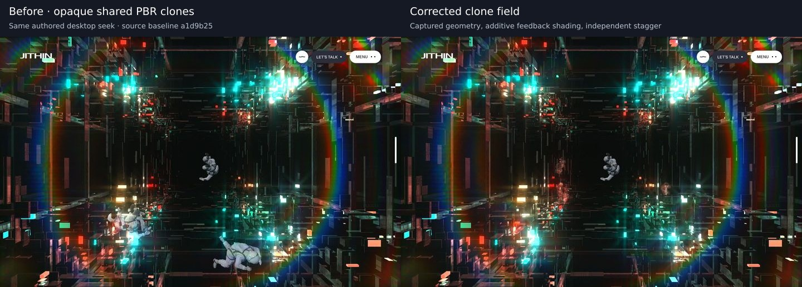

# Whole-project graphics and motion audit — corrective pass

## Result

This pass **changes the application**, rather than merely listing discrepancies. Five related defects are corrected: opaque vortex-clone materials, duplicated clone skinning/draw work, inherited clone root motion, missing clone-reflection filtering, and case-study media readiness. The approved primary astronaut, blue-flight framing, glass compositor, selected-project opening/reverse, About expertise and held-pour interaction were deliberately protected.

**Current preview:** port **3003**, production build **`o5CuzEoJWvEJZ5UwY8yTV`**. All **22 canonical HTML responses and 26 JS/CSS resources** were compared byte-for-byte with that build. The before-source baseline was `a1d9b25`; its captures were made before these changes, but its served files were not separately byte-fingerprinted.

**Not a declaration of exact parity:** the normal autonomous Home test still fails its distinct-blue-pose gate in Chromium/SwiftShader. Primary downstream astronaut shading/dynamics, About depth/light integration, cold loading, footer/menu polish and case text emphasis remain documented work. No physical GPU or phone was available for performance acceptance.



[Portrait comparison](../validation/whole-project-graphics/mobile-before-after.jpg) · [Durable measurements and build identity](../validation/whole-project-graphics/summary.json)

## Evidence and limits

1. **Fresh served build:** 24 before and 24 final cinematic phase captures at 1440×900 and 390×844; 68 final GPU phase assertions across desktop/portrait and normal/reduced authored seeks; 44 final route/viewport observations covering Home, About, archive and all 19 cases. Screenshots and inspection of source are not moving-reference parity tests.
2. **Supplied films re-examined:** `Lusion-home.mp4` (45.45s), `Lusion-about.mp4` (42.23s), `Lusion-project.mp4` (33.27s), and `2026-11-06 17-30-56.mp4` (33.78s). Timestamped overview sheets and exact Home 25/27/29/31s frames were regenerated under ignored `temp/full-audit/`. Film browser chrome, letterboxing, unknown DPR/input history and local stochastic state prevent a legitimate pixel-error score between these recordings and the preview.
3. **Live content refreshed:** https://lusion.co/, https://lusion.co/about and https://lusion.co/projects confirm the canonical sections, 19-case archive, About recognition/expertise and shared footer. The browser's attempt to render the live Home page failed with `net::ERR_CONNECTION_CLOSED`; live text extraction succeeded, but **live WebGL motion was not rendered here**. The films and archived equations, not text extraction, support graphics conclusions.
4. **Archived implementation:** `quangminh1212/Design_Lusion.co`, `_astro/hoisted.CUO_IjfL.js`, blob **`0c57277a2102a61f761357ce2cd432d035cd0a13`**. Retrieved again for this pass and inspected as source, not executed as a replacement application. Key anchors: `GoalTunnelAstronauts`, `vert$g`, `fragBlack`/`IS_CLONE`, `Blur.blur`, `ProjectDetailsItem.update`, and `frag$e`. These establish specific program differences; they do not prove that every detail of this archive matches today's live site.
5. **Footer evidence correction:** `Lusion-about.mp4` ends on the CTA, but the supplementary **`2026-11-06 17-30-56.mp4` does show the About footer and next-Projects panel at approximately 33s**. The older blanket statement that no supplied About-footer footage existed is superseded. That final view establishes layout/content, not precise entrance timing or input history.

## Implemented defects: difference → cause → correction

### F34 — opaque secondary astronauts instead of reflected additive suits

- **Reference:** four real astronaut copies use their own black-tunnel shader family. Reflection comes from tunnel feedback, normal mapping, metalness, AO and Fresnel; blending is additive `ONE + ONE`, double-sided, without depth testing. Alpha is the source luminance/visibility/end-ratio light-selection channel, not ordinary display coverage.
- **Before / perceptual consequence:** the copies reused the primary's bright physical suit/visor materials. They read as solid duplicate foreground people instead of a secondary, environment-driven layer in the shaft.
- **Root cause:** `loadLusionAstronautParts` returned the same `partMaterials` for every captured rig; `GoalTunnelSection` bridged that PBR family for every clone.
- **Implemented:** isolated `GoalReferenceCloneShaders.ts` and `GoalReferenceClones.ts`. The clone fragment preserves the native diffuse/specular feedback samples, `.25` polar lookup, `3.5` reflection factors, Fresnel response and source alpha equation. Helmet glass uses the helmet ARM/normal maps, as in the native clone family. No arbitrary green color, sprite replacement or global light boost was added.
- **Boundary:** this does **not** replace the primary astronaut's praised emergence/PBR materials. Its downstream black/white shader mismatch remains open below.

### F35 — four duplicated skeleton/material passes instead of clone instancing

- **Reference:** four instances per suit part, with the captured 53-bone, frame-major animation palette sampled in the vertex shader. Bone influence and adjacent animation frames blend transformed points, not an averaged dual quaternion.
- **Before / perceptual consequence:** four independent skinned rigs needed 16 part draws and CPU palette updates. Their deformation also inherited the primary's DQ adapter rather than the clone shader's frame interpolation.
- **Root cause:** `createClone()` constructed another `Skeleton`/four `SkinnedMesh` objects for each copy.
- **Implemented:** one four-instance draw for each of the four captured parts; two nearest-filtered **53×288 RGBA float textures** preserve the original position/orientation samples. Per-instance position, quaternion and frame triplet are the only moving attributes. The captured source's from-frame normal/tangent ordering is retained rather than silently “corrected.” The unused white-exit animation branch is omitted because these clones are hidden in white flight.
- **Measured:** the clone geometry pass falls **16 → 4 draws**. With the five reflection-filter draws described below, total scene/postprocessing calls at reduced authored tunnel `.4` and `.72` fall **66 → 59**, with identical **261,489 total triangles** in the measured desktop states. This is not an FPS measurement or proof that blue-flight delivery is fixed.

### F36 — all clones inherited the primary's already-noisy root

- **Reference:** clone transforms have their own Brownian origin and orientation. Only their positions interpolate toward the primary during separation; the source staggers with `g=1..4`, delay `g/(4−1)*.3`, and a `.7` sine-in-out window.
- **Before / perceptual consequence:** the primary's perturbed position/orientation were reused as every clone's base, then another noise transform was added. Separation was simultaneous and linear, so the copies stayed excessively correlated with the foreground character.
- **Root cause:** the clone loop reused `_rootPosition` and `_rootOrientation` after those temporaries already included the main noise transform.
- **Implemented:** each clone samples its own existing deterministic Brownian path, then applies the source position-only reveal interpolation. `goalCloneMainWeight` preserves the source's late fourth-clone endpoint, including its `g=4` delay. Forward/reverse authored sampling remains deterministic.
- **Remaining:** deterministic Brownian sampling is still an adaptation of the live source's second-order dynamics. This pass does not claim complete stochastic or temporal equivalence.

### F37 — clone reflections require filtered feedback, not raw neon pixels

- **Reference:** astronaut feedback is copied to a half-size, power-of-two RGBA8 target; two nine-tap separable filters run at radii **16**, then **4**, with half-size intermediates.
- **Consequence if omitted:** directly sampling raw feedback produces sparkling, high-frequency colored patches rather than broad environment reflections. An initial shader-only candidate exposed exactly this problem; that candidate is not the delivered build.
- **Implemented:** `GoalCloneReflection.ts` performs one copy plus four filter draws under the existing scene owner, only while clones are visible. At 1440×900/DPR1, the native sizing gives a 512×256 output and 256×128 intermediate. The output stays RGBA8, preserving the bounded feedback boundary.
- **Ownership:** no new renderer, RAF, event listener, scene recapture or scroll smoother. Targets/materials/quad are tracked for disposal. Tests check read/write non-aliasing and restoration of the previous render target/auto-clear even if rendering throws. Warmup and the existing architecture/foreground split include the new group.

### F38 — media entrance was incorrectly standing in for decoded-source readiness

- **Reference:** case media has two independent coordinates: a one-second expo-out **active** entrance and a one-second **linear readiness** ratio, which advances only after the texture loads. Color mixes from the project's highlight to the texture by readiness. Readiness continues offscreen; entrance resets offscreen.
- **Before / perceptual consequence:** a decoded texture immediately replaced the placeholder. `CaseStudyGraphics` only had `uReveal`; late images could pop in after their entrance had already finished. A new responsive source had no readiness lifetime.
- **Root cause:** `CasePanelFrame`/`CaseStudyMotion` tracked visibility time but no decoded-source state; the media fragment sampled texture RGB directly.
- **Implemented across all 19 cases:** `case-media-readiness.ts` tracks source identity, sticky decoded status and linear readiness under the existing case clock. `CaseStudyMotion` updates it even offscreen. `CaseStudyGraphics` adds independent `uReady` and project highlight color, explicitly preserving the source's unmanaged color convention without globally disabling Three color management. Entrance/fullscreen masks, native image resolution, eight-tap scroll effect, foliage and thumbnail/reverse are retained.
- **Policies:** a changed `currentSrc` resets readiness; a loaded source does not re-fade merely because it re-enters or a video buffers. Reduced motion shows decoded media immediately. Failed/unready textures retain DOM fallback. No new timer or per-media RAF.
- **Actual GPU integration:** a delayed real Atlas image stayed at readiness 0 despite being active for over a second; actual `uReady` then interpolated after decoding. Reverse kept readiness 1. Source replacement restarted the lifetime. Portrait reduced rendering passed. This test probes actual WebGL uniforms, not just data attributes.

## All 18 requested areas

**Status:** **fixed** = changes above; **confirmed open** = source/code discrepancy still present; **calibration** = adaptation needing matched moving evidence; **protected** = implemented/approved, not missing. The table deliberately does not label every difference a defect.

| Area | Reference / current assessment and perceptual consequence | Responsible files and exact next action |
|---|---|---|
| **1. Hero** | **Protected + calibration.** The opening has the native cross geometry, 22/24-body solver, pointer-ray interaction and source-derived reflective/refractive material. It is not the old flat/video approximation. Different random body poses alone do not establish bad physics. | `HeroCrossesStage.tsx`, `NativeHeroScene.ts`, `NativeHeroShaders.ts`, `src/lib/home-native-physics.ts`. Preserve counts/assets and drag-release behavior. For further correction, replay identical initial bodies, camera, pointer ray and elapsed time; compare highlights, contact response and settling before changing roughness, exposure or forces. |
| **2. Astronaut** | **Clones fixed; primary confirmed open.** The primary still uses physical suit/visor materials and a DQ adapter downstream, whereas native black/white families are self-lit and use transformed-point/frame blending. This can change seam deformation, visor reflections and apparent depth even with correct root framing. Native second-order floating remains adapted. | `AstronautEmergenceAssets.ts`, `GoalTunnelSection.tsx`, `GoalReferenceWorlds.ts`. Isolate and port **downstream only** black/white programs behind the emergence boundary; compare captured root/pose and suit/visor bounds at matched phases. Restore position dynamics `(1,.65,1.3)` and rotation `(1,.85,1.1)` through deterministic checkpoint/replay under the single playhead. Do not globally resize the already-corrected astronaut or add more pointer lag. |
| **3. Vortex** | **F34–F37 fixed.** Real instanced secondary suits now have additive filtered feedback and independent staged separation. Existing shaft density and stereographic fold are source-shaped, not an absent central vortex. Random phase and source feedback history still affect the moving result. | `GoalReferenceClones.ts`, `GoalReferenceCloneShaders.ts`, `GoalCloneReflection.ts`, `GoalReferenceWorlds.ts`, `GoalReferenceShaders.ts`. Preserve 96+456 grid instances. Compare straight shaft (~29–31s Home) separately from folded shaft (~33s); hold offset, transform ratio, colors and camera constant before tuning rotation/speed/bloom. No extra cage or invented swirl emitter. |
| **4. Blue tunnel** | **Prior fixes preserved; performance open.** Native base/wall instances, 4D cellular bands, depth travel, aperture and flight-noise/bloom phase mapping are present. The main current failure is too few distinct blue poses during autonomous software playback—not a demonstrated need for extra particles or arbitrary radial blur. | `GoalReferenceWorlds.ts`, `GoalReferenceShaders.ts`, `GoalReferenceBloomPass.ts`, `GoalTunnelSection.tsx`. Separate main-thread submission, GPU/driver backpressure, first-use compilation and presentation. Require advancing poses and independent architecture travel before considering an adaptive pixel/FFT tier. Keep the 20-second authored clock; do not stretch it to pass. |
| **5. Glass break** | **Prior F31–F33 preserved.** 946 shards × 15 captured rigid frames, immediate onset, post-display refraction/foreground ownership and near-camera `.416` depth are present. These are not missing rigid-body physics. Aperture fit, sidedness/depth-write and viewport adaptation remain calibration items. | `GoalReferenceOverlayPass.ts`, `GoalReferenceWorlds.ts`, `GoalTunnelSection.tsx`, `GoalReferenceShaders.ts`. Match the film's 38–39s approach/impact/drop against the same viewport and root pose; inspect stencil edge, shard silhouettes/occlusion, camera-relative travel and final shrink. Preserve opaque final display and don't simulate an unrelated explosion. |
| **6. About** | **Protected + confirmed depth/light adaptation.** Source terrain, world particles, team face/drag, brands, recognition paint, expertise ribbons/cards and contact pour exist. Ground/fog intersection and light integration are not fully native: the world still uses a simplified fog path and placeholder ground-shadow input. This can weaken contact/depth rather than requiring more particles. | `AboutPageView.tsx`, `AboutReferenceWorld.ts`, `AboutReferenceParticles.ts`, `AboutScenePost.ts`, `AboutSourceTeam.ts`, `AboutRecognitionPaint.ts`, `AboutExpertiseMotion.ts`, `AboutContactFluid.ts`. Match camera/scroll/selection and pointer history to About 0–20s before introducing the missing depth/light/soft-particle prepass. Compare recognition paint with identical sweeps. Protect the praised ribbons, turn/spread/bob and collective downward pour. |
| **7. Projects** | **Readiness fixed; archive/zoom protected; text emphasis confirmed open.** All 19 source cases, depth thumbnails, dark Atlas theme, gallery, RGB foliage and selected-card reverse exist. Of The Oak/Worldcoin paragraphs remain fully static instead of progressively emphasized. | `ProjectsArchiveMotion.ts`, `ProjectZoomSurface.ts`, `LusionProjectDetailView.tsx`, `CaseStudyMotion.ts`, `CaseStudyGraphics.ts`. Preserve current list/depth/clarity. For text panels, implement semantic allowed-font emphasis only while native viewport progress is `.2–.8`, advancing at `50/max(30,content.length)` and resetting offscreen; reduced text stays fully readable. Do not add universal media parallax: captured per-item ratios default to 1. |
| **8. Navigation** | **Protected + confirmed backdrop mismatch.** The menu's main stagger/tilt and focus/Escape behavior are present. Its residual backdrop uses a local 300ms opacity/813px split, versus archived 400ms/directional behavior and a 1000px backdrop boundary. The intermediate desktop width can therefore feel visually different. | `src/components/foundation/StudioHud.tsx` and its scoped styles. Capture open/close at 812, 813, 999 and 1000px before aligning backdrop opacity/composition/delay. Keep semantic navigation, focus trap and pending-route cancellation; add no particles. |
| **9. Page transitions** | **Protected + lifecycle calibration.** Native generic aperture and source-aware selected-list opening/reverse are implemented. Actual final-build keyboard next/Home origin, quarter-height return, Escape, resize and context-loss checks passed. Specialized metadata/next-preview timing still needs matched normal-motion comparison. | `TransitionProvider.tsx`, `RouteTransitionMotion.ts`, `ProjectZoomSurface.ts`, `project-transition.ts`, `CaseStudyMotion.ts`. Compare outgoing selection, covered preparation and destination disclosure as one transaction. Correct only a measured boundary/window; don't replace live depth animation with CSS scaling or regress to generic-only navigation. |
| **10. Loading** | **Confirmed open.** `Preloader.tsx` still uses synthetic short progress, static digit content and a local logo fade/scale. Native loading derives from eligible asset/init work, rolling digits and completed-bar/aperture phases. The build can visually announce completion independently of scene preparation. | `Preloader.tsx` and the existing readiness/store boundary. Feed required task progress, preserve native minimum preload/init/start phases (1s / .25s / .25s), init contribution .3 and digit damping `1−exp(−7dt)`. Include slow delivery/Skip/failure/reduced/warm entries. Do not claim a synthetic percent certifies GPU readiness or wait for every optional film. |
| **11. Scroll** | **Existing clarity fix protected; Home delivery still failing.** Case screen input is signed per-frame normalized displacement, not another integrated velocity; rest blur is zero. Readiness now shares that owner. Home normal-playback polls still repeat the same blue pose. | `SmoothScrollProvider.tsx`, `case-study-motion.ts`, `CaseStudyMotion.ts`, `GoalTunnelSection.tsx`. Keep one document/Lenis coordinate and one cinematic playhead. Profile delivered/submitted/presented states separately; repeated timer polls are not frames. Preserve native mobile document scroll and modal/hidden pause. |
| **12. Mouse** | **Protected + dynamics calibration.** Hero ray response, depth-card hover, case foliage pointer, About hold/wake and cursor feedback are present. Exact astronaut follow/floating and stochastic particle response are not certified by a static screenshot. | `pointer-motion.ts`, `CustomCursor.tsx`, `GoalTunnelSection.tsx`, `CaseStudyShadows.ts`, About contact modules. Use identical normalized pointer paths/dwell/release times. Restore source second-order response where established, rather than stacking a spring over an already-damped coordinate. Keep coarse-pointer/reduced/cancel and quick-click mailto policies. |
| **13. Camera** | **Calibration.** World scale `.208`, primary captured root curves and prior blue/monitor projection fixes remain. Portrait FOV 76 and DOM aperture mapping are local responsive adaptations; desktop-only film cannot establish an exact portrait lens. | `GoalTunnelSection.tsx`, `GoalReferenceWorlds.ts`, About native world/team camera modules. Measure root and skinned head/body bounds, horizon, aperture and near-plane fit at identical aspect/progress. Do not call a root projection a measured head location or retune all scales from one frame. |
| **14. Lights** | **Clone response fixed; primary/About integration open.** Native clones now reflect the tunnel instead of inheriting PBR light uniforms. Primary black/white suit lighting is still approximate; About contact/fog shadows have the limitation above. | Clone shader/filter files; `AstronautEmergenceAssets.ts`, `GoalTunnelSection.tsx`, `AboutReferenceWorld.ts`. Port the actual downstream light equations and depth/shadow inputs, keeping the correctly synchronized overlay lights for the current primary. Avoid a global exposure/color-temperature change across approved scenes. |
| **15. Materials / shaders** | **Clone family fixed; known primary/fog deviations remain.** Gamma/alpha are pipeline data: clone alpha selects bloom, final display is opaque, late glass uses finished color. The gallery highlight uses the archive's unmanaged colors explicitly. Wrong cross-family reuse was the cause, not absent detail maps. | `GoalReferenceCloneShaders.ts`, `GoalCloneReflection.ts`, `GoalReferenceBloomPass.ts`, `GoalReferenceOverlayPass.ts`, `CaseStudyGraphics.ts`, primary/About files above. Compare intermediate RGB/alpha at the proper pass boundary. Preserve RGBA8 feedback, float FFT scratch and no read/write aliasing; don't globally disable color management. |
| **16. Physics** | **Clone deformation/roots fixed; dynamic fidelity remains bounded.** Hero rigid bodies, captured astronaut animation, baked glass and contact/particle simulation are different systems. Encoded films in case studies already contain their own offline cloth/particles; page-level re-simulation would be an invention. | `home-native-physics.ts`, clone palette/transform code, `GoalDownstreamScenes.ts`, `AboutContactFluid.ts`, `ProjectsContactField.ts`. Match initial conditions/input/time for live dynamics; retain captured frame-major transforms for authored effects. Require pause/reverse/checkpoint continuity before any second-order upgrade. No new physics dependency is justified. |
| **17. Particles** | **Protected; no blanket missing-emitter finding.** About has its source world field and collective CTA wake; Projects has native contact glyphs; the tunnel's scintillation is mainly geometry/emission/feedback. Extra floating dust/confetti would not make it more faithful. | `AboutReferenceParticles.ts`, `AboutContactField.tsx`, `AboutContactFluid.ts`, `ProjectsContactField.ts`, `GoalReferenceShaders.ts`. Compare emitter density, sprite/depth softness, gravity and dissipation only with matched held paths/time. The confirmed About depth/light gap should be solved as depth/light integration, not by multiplying particle counts. |
| **18. Motion consistency** | **Readiness and clone separation fixed; shared polish open.** Updated effects have one existing owner and preserve hidden/menu/modal/reduced policy. Footer grouped editorial entrances are still absent; cursor/audio envelope equivalence has not been measured. This can make the lower page feel less choreographed even when content is correct. | `StudioFooter.tsx`, `ScrollPortalMotion.ts`, `CustomCursor.tsx`, `src/lib/audio.ts`, `CaseStudyMotion.ts`. Restore reversible line/word footer reveals using the existing scroll source: native line stagger .1, 1.5em travel, .6s word phase and .3/.3 up-control delay/duration. Validate against supplementary About ~33s plus Home ~44s. Compare audio after gesture unlock; preserve one journey owner, mute persistence and cancellation. |

### Responsive and performance boundaries

- Fresh observations cover **1440×900** and **390×844**, not real mobile GPU/thermal behavior. 812/813 remains the native case layout switch. Menu backdrop's separate source boundary must not be conflated with it.
- Physical GPU selection of quality tiers is still open. The existing software-only pixel budget was not reduced further, the clock was not stretched, and no intermediate-stage assertion was loosened.
- JITHIN customization, Font Option 2/commercial-font allowlisting and readable DOM/reduced/WebGL fallbacks remain intentional. Font-outline equality is not claimed. Utility/alias pages are preserved but are not additional original canonical routes.

## Final verification and unresolved failure

| Check | Actual final-build result |
|---|---|
| Production build, ESLint, strict TS, diff check | **PASS**. Preview 3003 serves build `o5CuzEoJWvEJZ5UwY8yTV`; 22 HTML + 26 JS/CSS byte matches. |
| Clone/math/renderer-double regression | **PASS**: all palette positions/orientations, native stagger, independent roots, reversible sampling, four instances per part, blend/depth state, exact 16/4 filter schedule, no target aliasing, throw-path restoration. Numerical/renderer-double checks are not pixel parity. |
| Native phase assertions | **PASS 68** actual GPU observations: desktop/portrait × normal/reduced authored seeks, framing/glass/opaque pixels. |
| Full reduced cinematic integration | **PASS both widths**: 11 states, reverse, four handoffs, assets, cleanup, astronaut/glass/WebGL failure isolation. |
| Normal autonomous Home | **FAIL — `captured blue-flight pose keeps advancing`**. 200 playing timer polls, 29 distinct progress values, 15 blue-window polls but **only 1 distinct blue pose**, 20.810s including activation. Zero uncaught errors/failed assets. It passed the earlier stage-presence assertion this time, but not the distinct-pose assertion. |
| Fresh baseline autonomous run | **FAIL — stage-presence gate**. 202 playing polls, 16 distinct progress values, 2 blue poses, 21.073s including activation. These two runs do not establish a causal FPS improvement or regression. |
| Whole canonical route inventory | **44 observations**, all 22 pages at both widths: zero uncaught page errors and zero horizontal overflow. Static/reduced inventory, not 44 matched moving comparisons. |
| Readiness GPU integration | **PASS** delayed real image, interpolated shader uniform, reverse persistence, source replacement and portrait reduced behavior. |
| Real Atlas clarity | **PASS DPR1/2**: exact 1440×900 / 2880×1800 buffers, GL error 0, rest scroll-strength 0. DOM/GPU crop RMSE ~6.15350 / 6.03411 includes foliage/lighting, not an isolated sharpness or reference score. |
| Selected-project lifecycle | **PASS** keyboard open/next, Home origin through case chain, quarter-viewport return, direct-entry Back, actual context loss mid-zoom, responsive resize and Escape cleanup. |
| Protected-feature numerical/source suites | **PASS** native Home physics/pointer/motion, editorial, About expertise, Projects data/contact, route motion, zoom and case shadows. These were rerun; unchanged About hold/team/audio interactions were not all newly filmed end-to-end. |

**Inventory tooling correction:** the initial run saved all 22 desktop observations, then bundled single-process Chromium closed when its final context closed, before mobile could start. `audit-site-fidelity.mjs` now launches a fresh browser per width and supports explicit `AUDIT_WIDTHS`. An independent 22-route mobile run completed. This was a test-harness lifetime failure, not an application route failure, and is not hidden as an initial 44-route pass. The durable summary combines the two completed same-build sets.

### Priority after this delivery

1. **P0: distinct blue/glass frame delivery.** Instrument actual render submissions and presented frames; phase-tag asynchronous GPU measurements where available. Separate first-use compilation, draw execution, backpressure and main-thread work. Validate a physical GPU/phone before choosing adaptive quality. Keep the existing normal gate intact.
2. **P1: primary downstream shader/deformation/dynamics isolation.** Port native black/white suit families without touching approved emergence; reconstruct second-order trajectories with deterministic seek/replay.
3. **P1: About depth/light completion.** Match a filmed terrain/fog/person state first, then add the missing depth/light contact path under the existing owner.
4. **P2: case semantic text emphasis, real loader, footer/menu polish.** Each has a precise source-backed target above. Keep thumbnail/reverse, crisp gallery and approved particles intact.

## Reproduction

```bash
npm run build
PORT=3003 npm run start
# In another terminal:
BASE_URL=http://127.0.0.1:3003 node scripts/validate-case-media-readiness.mjs
node scripts/test-goal-sequence.mjs
node scripts/test-case-study-clarity.mjs
BASE_URL=http://127.0.0.1:3003 node scripts/validate-home-tunnel-framing.mjs
BASE_URL=http://127.0.0.1:3003 GOAL_VIEWPORT_WIDTH=1440 node scripts/validate-goal-sequence.mjs
BASE_URL=http://127.0.0.1:3003 GOAL_VIEWPORT_WIDTH=390 node scripts/validate-goal-sequence.mjs
# Expected to expose the unresolved software distinct-pose failure:
BASE_URL=http://127.0.0.1:3003 GOAL_MOTION=normal node scripts/validate-goal-sequence.mjs
BASE_URL=http://127.0.0.1:3003 AUDIT_PHASE=whole-project node scripts/audit-site-fidelity.mjs
```

Detailed temporary browser reports remain under `temp/full-audit/`, `temp/cinematic-validation/` and `temp/site-fidelity-audit/`; they are intentionally ignored. The concise durable evidence is `docs/validation/whole-project-graphics/`.
